# AI Task Monitor

[Русский](#русский) · [English](#english)

## Русский

AI Task Monitor — бесплатное приложение для Windows 11 и macOS, которое помогает следить за локальными задачами Codex и Claude Code в одном окне.

- Показывает доступные задачи и сведения о действиях; неподтверждённый статус отмечает отдельно.
- Если агент опубликовал план, отображает его этапы и долю выполненных этапов. Одновременно в карточке видно до пяти этапов; остальные можно прокрутить.
- Без плана показывает доступную активность; процент не выводится, если данных для оценки недостаточно. Приблизительная оценка помечается знаком `≈`.
- Компактное окно можно держать поверх других окон и переключать задачи; настройки доступны в развёрнутом режиме. В macOS окно становится активным при наведении.
- Локальный диагностический журнал и предупреждение о возможном цикле помогают следить за работой. Предупреждение приблизительное и не останавливает задачу.

### Установка

Сборки для Windows и macOS доступны в [Releases](https://github.com/trueakaru-stack/ai-task-monitor/releases); перед установкой проверьте прилагаемую контрольную сумму SHA-256.

Установщик Windows не подписан доверенным сертификатом, поэтому SmartScreen может показать предупреждение. Сборка macOS подписана ad hoc и не нотарифицирована Apple; Gatekeeper может предупредить или заблокировать запуск.

Исходники Windows находятся в ветке `windows`, macOS — в ветке `macos`. Состояние отдельных веток и опубликованных сборок может различаться.

### Конфиденциальность и обратная связь

Данные задач обрабатываются локально. Приложение проверяет обновления через GitHub; GitHub получает IP-адрес, но не содержимое задач. Подробности: [Windows](https://github.com/trueakaru-stack/ai-task-monitor/blob/windows/PRIVACY.md) · [macOS](https://github.com/trueakaru-stack/ai-task-monitor/blob/macos/PRIVACY.md). Отзывы и предложения: truea.k.a.ru@gmail.com.

### Лицензия

Исходный код доступен по [лицензии проекта](LICENSE): бесплатное использование, включая внутреннюю работу организаций, разрешено; монетизация продуктов, содержащих код, ограничена. При первом использовании или изменении кода требуется уведомление правообладателя. Для простого запуска приложения уведомление не нужно. Это не лицензия open source, одобренная OSI.

## English

AI Task Monitor is a free Windows 11 and macOS app for following local Codex and Claude Code tasks in one window.

- Shows available tasks and activity, marking unconfirmed status separately.
- When an agent publishes a plan, shows its steps and the share of completed steps. Up to five steps are visible per card; the rest can be scrolled.
- Without a plan, shows available activity and omits the percentage when there is not enough information to estimate it. Estimated values use `≈`.
- A compact window can stay above other windows and switch between tasks; settings are available in the expanded view. On macOS, hovering over the window activates it.
- A local diagnostic journal and a possible-loop warning help monitor activity. The warning is heuristic and does not stop a task.

### Installation

Windows and macOS packages are available in [Releases](https://github.com/trueakaru-stack/ai-task-monitor/releases); verify the accompanying SHA-256 checksum before installation.

The Windows installer does not have a trusted code signature, so SmartScreen may display a warning. The macOS build is ad-hoc signed and not notarized by Apple; Gatekeeper may warn or block it.

Windows source is in the `windows` branch and macOS source is in `macos`. Branch contents and published packages may differ.

### Privacy and feedback

Task data is processed locally. The app checks GitHub for updates; GitHub receives the IP address, but not task contents. Details: [Windows](https://github.com/trueakaru-stack/ai-task-monitor/blob/windows/PRIVACY.md) · [macOS](https://github.com/trueakaru-stack/ai-task-monitor/blob/macos/PRIVACY.md). Feedback: truea.k.a.ru@gmail.com.

### License

The [project license](LICENSE) allows free use, including internal business use, but restricts monetization of products containing the code. Users must notify the copyright holder when first using or modifying the code; no notice is required just to run the app. This is not an OSI-approved open-source license.

## Скриншоты / Screenshots

### Windows 0.2.12

| Развёрнуто / Expanded | Компактно / Compact | Настройки / Settings |
| --- | --- | --- |
| 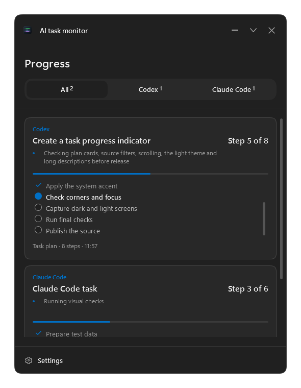 | 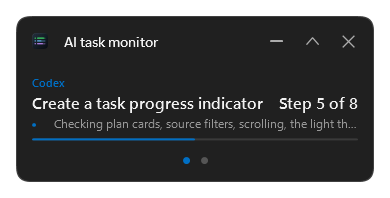 | 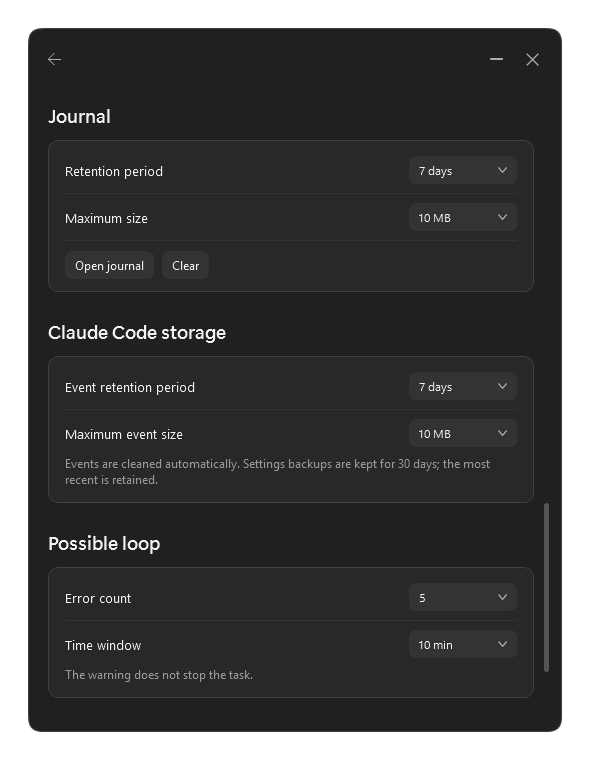 |
| 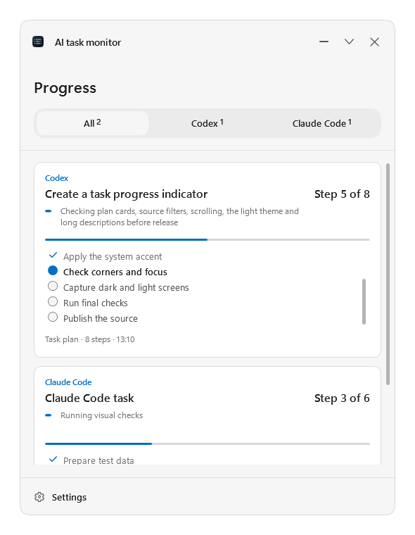 | 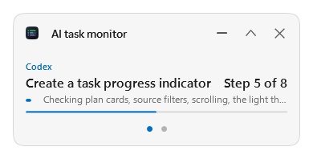 | 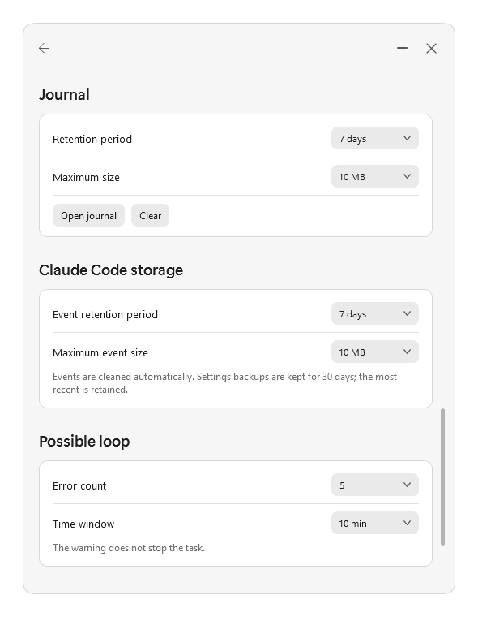 |

### macOS 0.3.11

| Развёрнуто / Expanded | Компактно / Compact | Настройки / Settings |
| --- | --- | --- |
| 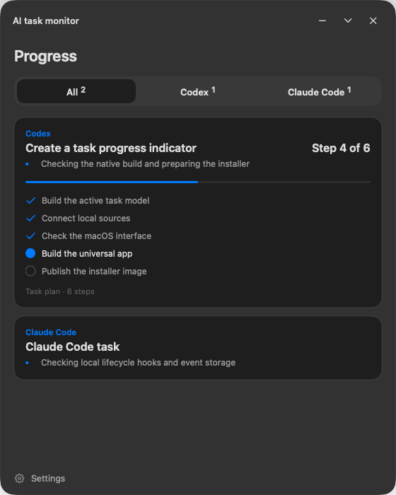 | 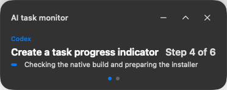 | 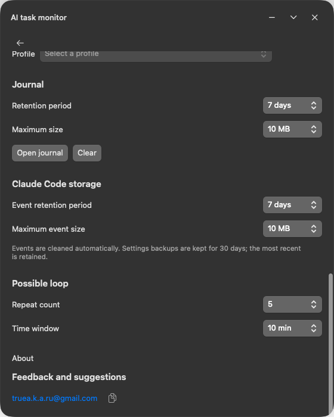 |
| 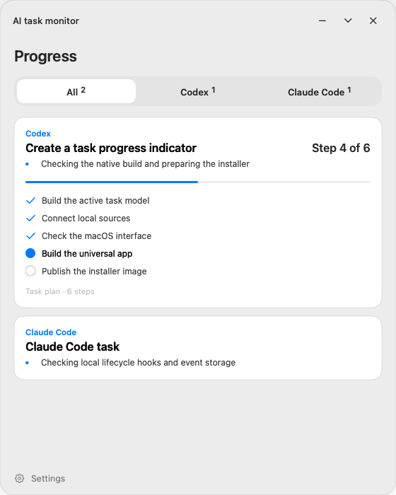 | 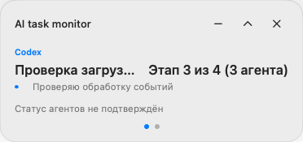 | 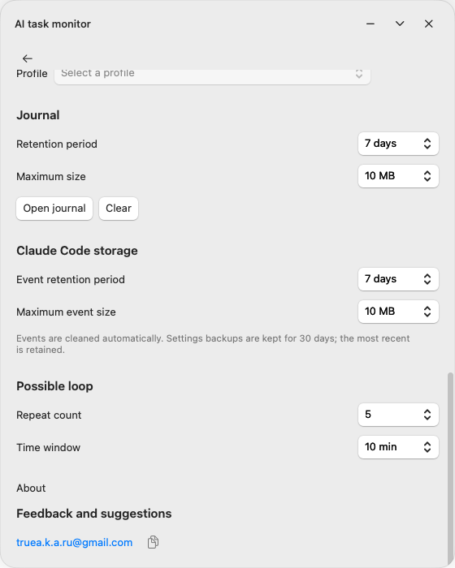 |

Задачи показаны для примера. Снимки macOS — превью интерфейса; системное оформление окна может отличаться.

The tasks shown are examples. The macOS images are interface previews; the system window appearance may differ.

AI Task Monitor is an independent project and is not affiliated with or endorsed by OpenAI or Anthropic.
AI Task Monitor — независимый проект, не связанный с OpenAI или Anthropic и не поддерживаемый ими.
