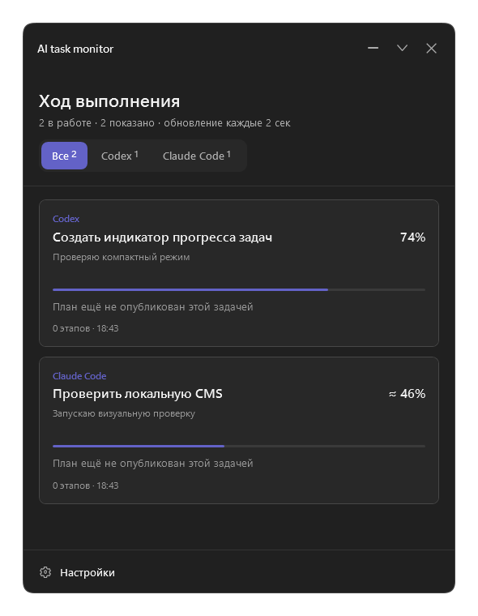
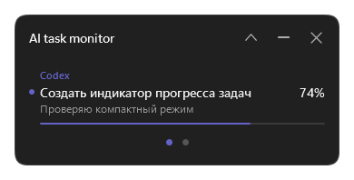
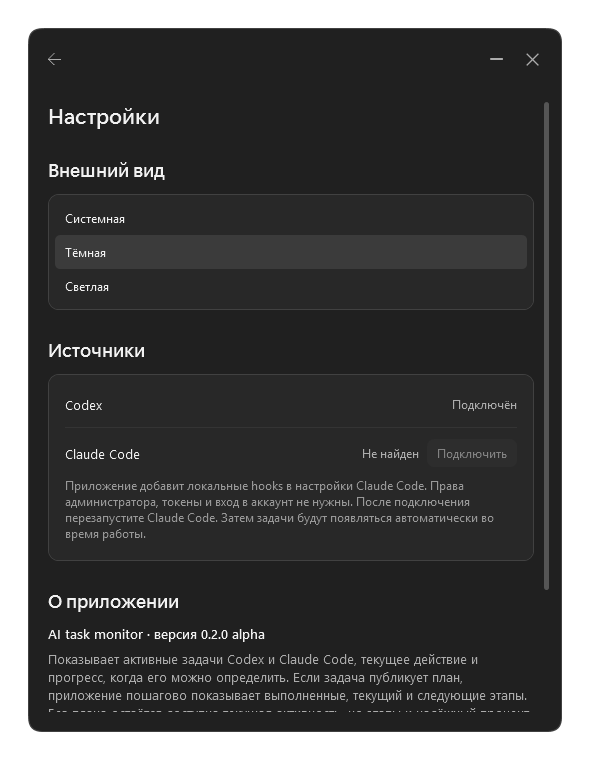
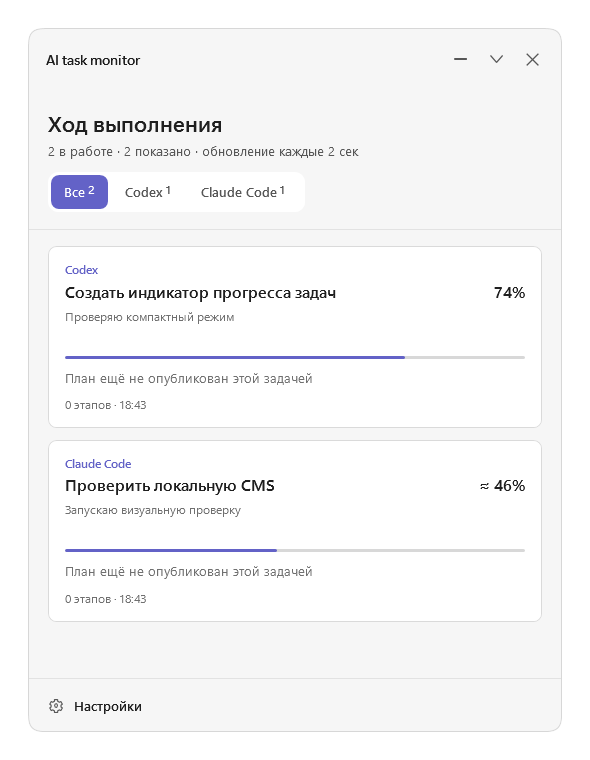
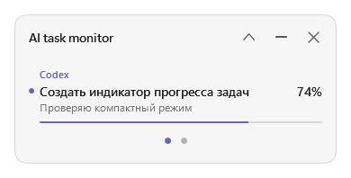
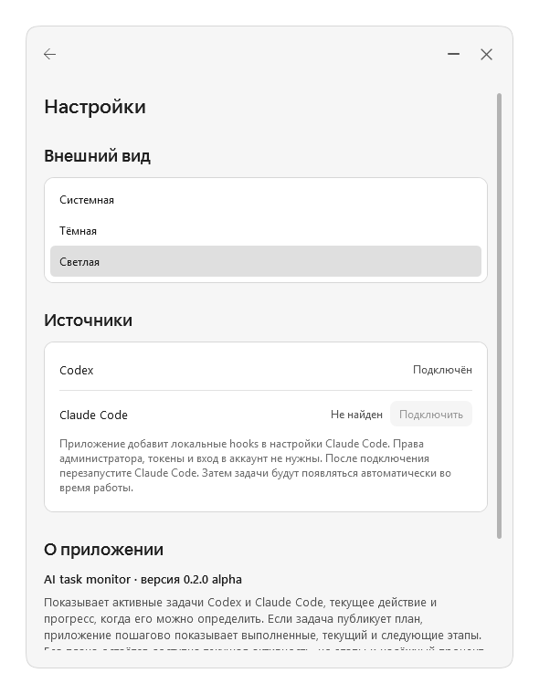

# AI Task Monitor

AI Task Monitor is a source-available desktop utility for viewing active Codex and Claude Code tasks in one compact window.

The application shows the current action and displays progress only when it can be supported by available task data. When a task publishes a plan, AI Task Monitor shows completed, current, and upcoming steps, keeps five steps visible in each card, and lets the user scroll through the rest. Without a plan, the current activity remains visible, but step details and a reliable percentage may be unavailable.

Exact progress is shown as a number, estimated progress uses `≈`, and activity without a reliable estimate has no percentage or progress bar. Settings are available only in the expanded window; compact mode is reserved for monitoring.

## Current status

Version 0.2.2 alpha is under active review. An unsigned Windows 11 installer is published through GitHub Releases. Windows may show a SmartScreen warning because the executable does not yet have a trusted code-signing certificate.

- `main` contains public documentation and reviewed screenshots.
- `windows` contains the current Windows 11 implementation.
- `macos` contains the native macOS implementation.

## Screenshots

| Expanded | Compact | Settings |
| --- | --- | --- |
|  |  |  |
|  |  |  |

The preview data in these screenshots is synthetic and contains no user task content.

## Privacy

Task information is processed locally. AI Task Monitor does not upload task titles, actions, plans, or logs. The app checks GitHub for platform-specific updates at startup and daily while open; GitHub receives the request and IP address. Feedback opens a user-controlled email draft. Read [PRIVACY.md](PRIVACY.md) for the exact local data paths and behavior.

## Independence

AI Task Monitor is an independent project. It is not affiliated with, endorsed by, or sponsored by OpenAI or Anthropic. Codex and Claude Code are referenced only to identify compatible task sources.

## Releases

Download the current Windows alpha from [GitHub Releases](https://github.com/trueakaru-stack/ai-task-monitor/releases). Verify the SHA-256 value published with the release before running it.

The current Windows package is unsigned and intended for alpha testing. A signed public build still requires clean-machine installation and removal tests, malware scanning, and a trusted Windows code-signing certificate. A separate macOS alpha disk image is available on the releases page; it is ad-hoc signed and not notarized.

## License

The [source-available license](LICENSE) permits free use, including internal workplace use, while restricting monetization of products containing the code. People who use or modify the code must send a first-use notice; simply running the application does not require a notice. This is not an OSI-approved open-source license.

