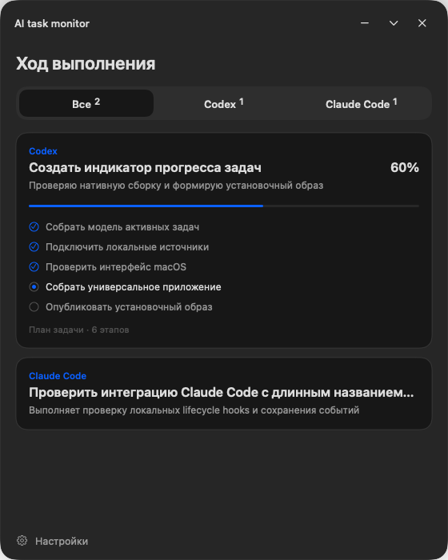
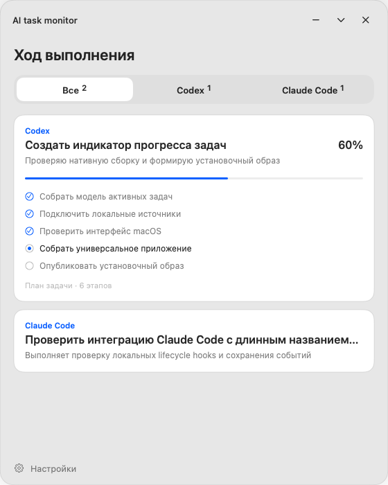
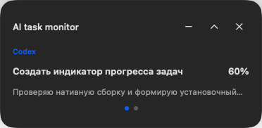
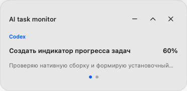
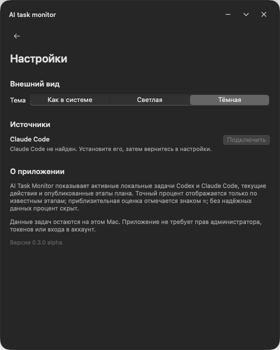
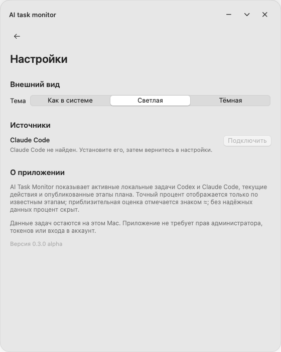

# macOS visual verification — 2026-11-02

## Baseline and renderer

- Product baseline: the accepted Windows AI Task Monitor expanded, compact, settings, provider-tab, plan-stage, and truncation-hint states in the public repository screenshots.
- Final artifact: native SwiftUI/AppKit build from macOS commit `6b7ac9b`.
- Renderer: GitHub-hosted macOS 14 runner, Xcode 16.1, native scale.
- Viewports: expanded and settings `560 × 700`; compact `372 × 182`.

## Inspected states

- Expanded mixed Codex and Claude Code tasks: dark and light.
- Planned Codex task with exact progress, five visible stages, active/pending/completed states, and stage count.
- Unplanned Claude Code task with current activity and no false percentage or progress bar.
- Provider tabs and superscript counts.
- Compact mixed-task carousel: dark and light.
- Settings, disabled unavailable-source action, appearance selection, and About copy: dark and light.
- Truncation hint surface: dark and light.

## Corrections made during comparison

- Replaced height-dependent card curvature, which produced capsule-like cards, with a 14-point continuous corner and a 10-point selected-tab inner corner.
- Replaced the standard tooltip with the application-owned compact hint surface. It appears only when text is truncated, uses a 4-point anchor gap, and follows light/dark appearance.
- Corrected dark hint text contrast after inspecting the first native render.

## Result

The final native screenshots preserve the accepted information hierarchy and behavior while using macOS system typography and controls. Outer window, cards, provider tabs, progress bar, step states, compact carousel, settings hierarchy, and tooltip contours show no clipping, corner bleed, or overflow in the inspected states. The macOS application has no supplied official brand icon, so the build intentionally retains the generic application icon rather than inventing one.

## Evidence

| State | Dark | Light |
| --- | --- | --- |
| Expanded |  |  |
| Compact |  |  |
| Settings |  |  |
| Hint |  |  |

Live pointer, keyboard-focus, and VoiceOver traversal still require confirmation on a physical Mac. Automated rendering and source accessibility labels do not replace that manual check.
